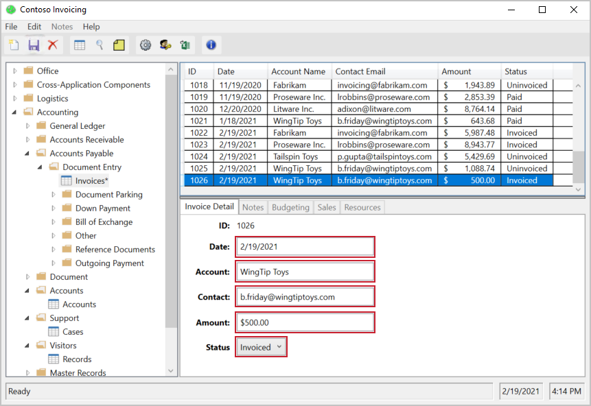

# Invoice Automation (Power Automate Desktop)

A Power Automate Desktop flow, built with the UI recorder, that automates a legacy Windows invoicing app. It opens the app, navigates to an invoice record, fills in the account, contact, date and amount fields, and sets the status to "Invoiced".

## At a glance

| | |
|---|---|
| **Type** | Power Automate Desktop flow (robotic process automation) |
| **Built with** | Power Automate Desktop and its UI recorder |
| **Target app** | Contoso Invoicing, Microsoft's sample Windows invoicing application |
| **Size** | 10 recorded actions in one flow |
| **Fields filled** | Account, Contact, Date, Amount, Status |

## Why this project

Many business processes still run through older desktop applications that have no API or integration option. Robotic process automation (RPA) handles these by mimicking what a person does on screen: clicking, selecting and typing. This project is a small, complete example of that approach, from recording the actions to testing the flow.

## What the flow does

1. Launches the Contoso Invoicing application using the **Run Application** action.
2. Navigates to an invoice record in the app.
3. Fills in the **Account**, **Contact**, **Date** and **Amount** fields.
4. Sets the **Status** to "Invoiced".
5. Saves the record.

## Input variables

The flow uses four text input variables so the values entered are not hardcoded:

| Variable | Data type | Description |
|---|---|---|
| `Account` | Text | The name of the account |
| `Amount` | Text | The amount of the invoice |
| `Contact` | Text | The contact email address |
| `Date` | Text | The invoice date |

## How it was built

1. **Created a desktop flow** in Power Automate Desktop and added a **Run Application** action pointing at the Contoso Invoicing app.
2. **Recorded the on-screen actions** with the desktop recorder while entering an invoice by hand. The recorder captures each click and text entry as an action in the flow.
3. **Edited the recorded actions**, replacing hardcoded values with variables where needed.
4. **Test ran the flow** and watched it reproduce the data entry in the Contoso Invoicing app.

### Flow Actions

This screenshot shows the actions configured in the Power Automate flow.

### Successful Execution

This screenshot shows the invoice record after the flow ran successfully, with its status set to "Invoiced".

## Running it yourself

1. Install **Power Automate for desktop** and sign in.
2. Download and install the **Contoso Invoicing** sample app from Microsoft Learn.
3. Create a new desktop flow and recreate the actions, or paste in the actions from `flow-actions.txt` if it is included in this repo.
4. Update the **Run Application** path to where Contoso Invoicing is installed on your machine.
5. Run the flow and avoid using the computer while it runs, since the recorded actions control the mouse and keyboard.

<!-- ADD FILE: flow-actions.txt (select all actions in the designer, copy, paste into a text file). Delete step 3's mention of it if you do not include one. -->

## Limitations

- This is a **desktop flow**, not a cloud flow. It has no triggers, connectors or approvals, and it runs only on a machine with Power Automate for desktop and the Contoso Invoicing app installed.
- The closing of the app is not recorded, so each run opens a new instance of Contoso Invoicing.
- Recorded UI actions depend on the app's on-screen controls, so the flow needs the app to look and behave as it did during recording.

## Background and credits

I built this flow while working through Microsoft Learn's Power Automate for desktop material, using Microsoft's **Contoso Invoicing** sample app. The app and the learning content belong to Microsoft. The flow in this repo is my own implementation of the exercise.

## Related

I hold four Microsoft Learn certifications across Power BI, Power Apps, Power Automate and SharePoint.

- GitHub: https://github.com/keeganchinyenze
- LinkedIn: https://www.linkedin.com/in/keeganchinyenze
